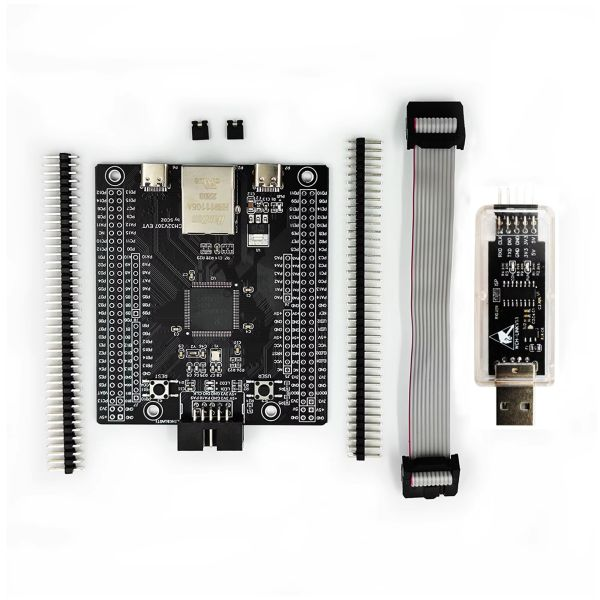

# CH32V307VCT6 (`CH32V307V-EVT-R1` Black)

The **CH32V307V-EVT-R1** (black PCB revision) is an evaluation board for the **CH32V307VCT6** 32-bit RISC-V connectivity-line microcontroller. It includes an Ethernet RJ45 jack, dual USB-C ports, Arduino-compatible headers, and full GPIO breakouts.

> [!NOTE]
> **No Onboard WCH-Link:** This board/revision does **not** have a built-in WCH-Link programmer/debugger (despite some product listings mentioning one). You will need an external **WCH-Link / WCH-LinkE** (or the USB ISP bootloader) to flash and debug it.

---

## Microcontroller Specifications (`CH32V307VCT6`)

| Feature | Specification |
| --- | --- |
| **Core** | QingKe V4F 32-bit RISC-V (`RV32IMACF`) with single-precision FPU, hardware interrupt stack & branch prediction |
| **Max Clock** | 144 MHz |
| **Package** | LQFP100 (80 GPIO pins) |
| **Memory** | Configurable Flash / SRAM split (default **256 KB Flash / 64 KB SRAM**, configurable up to 192 KB Flash / 128 KB SRAM or 288 KB Flash / 32 KB SRAM) |
| **Ethernet** | 10/100M Ethernet MAC with integrated 10M PHY |
| **USB** | 1x USB 2.0 High-Speed (480 Mbps) Host/Device with built-in PHY + 1x USB 2.0 Full-Speed OTG |
| **Serial / Bus** | Up to 8x USART/UART, 3x SPI, 2x I2C, 2x CAN, 1x SDIO, 2x I2S, FSMC |
| **Analog** | 2x 12-bit ADC (16 channels), 2x 12-bit DAC, 4x Op-Amps, TouchKey |
| **Timers & DMA** | 2x Advanced, 4x General-Purpose, 2x Basic, 2x SysTick/Watchdog; 2x DMA (18 channels total) |
| **Operating Voltage** | 2.5V – 3.3V (board regulated to 3.3V via onboard LDO) |

---

## Board Features & Layout

- **Programming / Debug Interface (External):**
  - No onboard WCH-Link is present on this revision; connect an external **WCH-Link / WCH-LinkE** to the `SWDIO`, `SWCLK`, `GND`, and `3V3` pins on the header, or use the built-in USB ISP bootloader.
- **Connectivity (Bottom Edge):**
  - **RJ45 Ethernet (`HanRun HR911105A`):** Connected directly to the CH32V307 internal Ethernet MAC/PHY.
  - **USB-C Ports (`P6`, `P7`):** Dedicated USB Type-C connectors for the MCU's USB 2.0 Full-Speed OTG and USB 2.0 High-Speed interfaces.
- **User I/O & Headers:**
  - **Buttons:** `RESET` (`S1`) and `USER` (`S2`).
  - **LEDs:** `LED1` and `LED2` (uncommitted by default — wire them to desired GPIO pins via jumper wires on the header).
  - **Expansion Headers:** Dual-row breakouts exposing all LQFP100 pins (`PA0–PA15`, `PB0–PB15`, `PC0–PC15`, `PD0–PD15`, `PE0–PE15`) alongside Arduino Uno-compatible inner headers.

---

## Programming & Development

- **Programmers:**
  - **External WCH-Link / WCH-LinkE:** Connect `3V3`, `GND`, `SWDIO`, and `SWCLK` to the board's debug/GPIO header.
  - **USB ISP Bootloader:** Hold `BOOT0` (or set the boot jumper) on reset and flash over USB using **WCHISPStudio** or `wchisp`.
- **IDEs & Toolchains:**
  - **MounRiver Studio (MRS)** — Official WCH IDE with RISC-V GCC toolchain and WCH-Link support.
  - **Embeetle IDE** — Supports the `CH32V307VCT6-EVT-R1-1v1` board out of the box.
  - **Open-source:** `riscv-none-elf-gcc` + `wlink` / `wchisp` / `OpenOCD` (WCH fork).
- **Quick Blinky Note:** `LED1`, `LED2`, and the `USER` (`KEY`) button are not hardwired to fixed GPIOs on this EVT board; connect them to free GPIO header pins (e.g., `PA0`/`PD0`) with jumper wires when running sample code.

---

## References

- [Elecrow Product Page (CH32V307V-EVT-R1)](https://www.elecrow.com/ch32v307-evaluation-board-risc-v-mcu-onboard-wch-link-ch32v307vct6-ch32v307v-evt-r1-wch.html)
- [YouTube Overview / Walkthrough](https://www.youtube.com/watch?v=oSX-UBAvIeE)
- [Official WCH CH32V307 GitHub Repository (SDK, Schematics & Examples)](https://github.com/openwch/ch32v307)
- [Embeetle Supported Hardware: CH32V307VCT6-EVT-R1-1v1](https://embeetle.com/#supported-hardware/wch/boards/ch32v307vct6-evt-r1-1v1)
