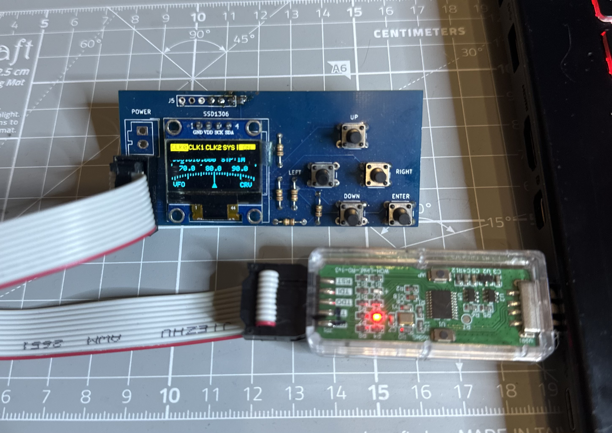

# CH32V003F4P6 + Si5351A Retro VFO & RF Signal Generator

A compact, bare-metal **3-channel RF Signal Generator & VFO** built on the **WCH CH32V003F4P6** (RISC-V, 16 KB Flash / 2 KB SRAM), driving a **Silicon Labs Si5351A (CJMCU-5351)** clock generator and a **128×64 dual-color SSD1306 OLED** with a **zero-extra-RAM Retro Vernier Drum Dial**.



---

## 1. Si5351A Capabilities & Architecture

The **Si5351A** (commonly found on **CJMCU-5351** breakout boards) is a programmable I2C CMOS clock generator capable of synthesizing three independent, low-jitter frequencies simultaneously from a single **25 MHz** (or 27 MHz) reference crystal.

| Parameter | Specification | Notes in This Firmware |
|---|---|---|
| **Channels** | 3 independent outputs (`CLK0`, `CLK1`, `CLK2`) | Each channel has its own frequency, step cursor, and `ON/OFF` state |
| **Frequency Range** | `2.5/8 kHz – 200 MHz` (datasheet) / up to `225 MHz` (VCO/4 OC) | Firmware tunes **`10 kHz – 225 MHz`** *(>200 MHz is overclocked and not guaranteed by Silicon Labs)* |
| **PLL Architecture** | Dual fractional PLLs (`PLLA`, `PLLB`) `600 – 900 MHz` | `PLLA` locked at `900 MHz` from `25 MHz` XTAL |
| **Dividers** | Fractional MultiSynth (`a + b/c`) + R-divider (`1..128`) | Smooth `1 Hz` to `100 MHz` step tuning |
| **Output Waveform** | `3.3V` CMOS square wave (`~50 Ω` output impedance) | AC-couple (`100 nF`) or low-pass filter for sine/RF use |
| **Drive Strength** | Programmable `2 mA`, `4 mA`, `6 mA`, `8 mA` | Controllable via register `SI5351_CLKx_CONTROL` |
| **I2C Interface** | `0x60` (7-bit address), up to `400 kHz` Fast Mode | Shares I2C1 bus with SSD1306 (`0x3C`) |

### Typical RF & Bench Uses
- **Superheterodyne VFO + BFO**: Run `CLK0` as the main VFO (with optional `+455 kHz` or `+10.7 MHz` IF offset) and `CLK1` as the BFO/carrier oscillator.
- **Direct-Conversion / SDR Quadrature**: Generate `I/Q` clocks or dual-channel test signals.
- **IF Alignment & Filter Sweeps**: Step cleanly in `1 Hz`, `10 Hz`, `100 Hz`, `1 kHz`, `10 kHz`, `100 kHz`, or `1 MHz` increments.

---

## 2. Hardware Wiring (CH32V003F4P6)

All I2C peripherals and 5 navigation buttons connect directly to **Port C** (defined in [`source/User/main.h`](source/User/main.h)):

| CH32V003 Pin | Signal | Connected To |
|---|---|---|
| **`PC1`** | `I2C1_SDA` | Si5351 `SDA` + SSD1306 `SDA` (with `4.7 kΩ` pull-up to `3.3V`) |
| **`PC2`** | `I2C1_SCL` | Si5351 `SCL` + SSD1306 `SCL` (with `4.7 kΩ` pull-up to `3.3V`) |
| **`PC3`** | `ENTER` | Tactile button (active-high input) |
| **`PC4`** | `DOWN` | Tactile button (active-high input) |
| **`PC5`** | `LEFT` | Tactile button (active-high input) |
| **`PC6`** | `RIGHT` | Tactile button (active-high input) |
| **`PC7`** | `UP` | Tactile button (active-high input) |
| **`3.3V` / `GND`** | Power | Regulated `3.3V` supply (use level-shifting if powering a 5V-only module) |

> See [`wiring.md`](wiring.md) for power and safety notes.

---

## 3. Retro Vernier Drum Dial UI (128×64 Dual-Color SSD1306)

The display is partitioned into the SSD1306's **16 px yellow top bar** and **48 px blue main area**:

```text
+------------------------------------------+
| [CLK0]  CLK1   CLK2   SYS  |    ON       |  <- 16 px YELLOW BAR (Tabs + Output)
+------------------------------------------+
| 145.000.000               STP:10k        |  <- Digital Readout + Step Size
|     ^                                    |  <- Active Digit Cursor
| |         ===                            |  <- Min..Max Limit Bar (10k..225M)
|  144.9      145.0      145.1             |  <- Sliding Scale Numbers
|   .  |  .  |  .  |  .  |  .  |  .  |     |  <- Parabolic Curved Drum Dial
| VFO               ▲                 CRV  |  <- Mode + Pointer (▲ ON / △ OFF)
+------------------------------------------+
```

### Visual Elements
- **Top Yellow Bar (`Y = 0..15`)**: Switch between `CLK0`, `CLK1`, `CLK2`, and `SYS` (3-channel overview). Shows `ON` (inverted) or `OFF` (outlined) for the active channel.
- **Digital Readout & Step (`Y = 16..27`)**: `XXX.XXX.XXX` Hz readout with an underline/caret under the active tuning digit and the active step size (`1 Hz` – `100 MHz`).
- **Min–Max Limit Bar (`Y = 28..30`)**: Full-span indicator from `10 kHz` (left stop) to `225 MHz` (right stop).
- **Parabolic Drum Dial (`Y = 31..55`)**:
  - Computed column-by-column in [`render_dial_column()`](source/User/main.c) with **0 bytes of extra RAM** beyond the main 1,024-byte OLED framebuffer and no floating-point math.
  - Parabolic edge droop (`dx² >> 9`) gives a 3D cylindrical drum illusion across all 128 pixels (toggleable between `CRV` and `FLT` in the Config menu).
  - Hard limit stop bars appear on the dial when approaching `10 kHz` or `225 MHz`.
- **Center Fiducial Pointer (`Y = 56..63`)**: Fixed hairline at `X = 64` with a **solid `▲`** when output is enabled and a **hollow `△`** when muted.

---

## 4. Button Controls Tutorial

| Button | In **Dial Focus** (Default) | In **Tab Focus** | In **Config Focus** |
|---|---|---|---|
| **`UP` / `DOWN`** | Tune frequency up/down (hold for 14–20 Hz auto-repeat) | Toggle active channel `ON` / `OFF` | Change setting (`DIAL: CURVED/FLAT`, `IF: 0 / 455k / 10.7M`) |
| **`LEFT` / `RIGHT`** | Move digit cursor (changes step size `100M` ↔ `1 Hz`) | Switch tab (`CLK0` / `CLK1` / `CLK2` / `SYS`) | Select config item |
| **`ENTER` (Short)** | Cycle focus: **Tabs → Dial → Config** | Cycle focus | Cycle focus |
| **`ENTER` (Hold 500 ms)** | **Mute / Unmute** active channel output (`▲` ↔ `△`) | **Mute / Unmute** active channel | **Mute / Unmute** active channel |

---

## 5. Building & Flashing (Embeetle Toolchain)

Two PowerShell helper scripts are included at the project root so you can build and flash from the terminal or directly inside Embeetle IDE:

```powershell
# Build firmware (ELF, BIN, HEX + size report)
.\build.ps1

# Clean and rebuild
.\build.ps1 -Clean

# Build and flash to CH32V003 via WCH-Link / OpenOCD
.\flash.ps1
```

### Resource Footprint (`-Og`, 16 KB Flash / 2 KB RAM)
- **Flash**: `16,380 / 16,384` bytes
- **RAM**: `1,496 / 2,048` bytes (including `1,024`-byte SSD1306 framebuffer and `256`-byte stack)

---

## 6. References & Helpful Tools
- **Original Inspiration**: [10 kHz to 225 MHz VFO/RF Generator with Si5351 (Arduino ProjectHub)](https://projecthub.arduino.cc/CesarSound/10khz-to-225mhz-vforf-generator-with-si5351-version-2-acdc25)
- **Video Demo**: [YouTube Reference](https://www.youtube.com/watch?v=5rPPO1e-Tls)
- **OLED Bitmap Converters**: [image2cpp](https://javl.github.io/image2cpp/) · [Bitluni Image2Header](https://bitluni.net/wp-content/uploads/2018/02/Image2Header.html)
